

  <picture>
    <source media="(prefers-color-scheme: dark)" srcset="https://raw.githubusercontent.com/Si-Hill/tado-dash/main/custom_components/tado_dash/brand/dark_logo.png">
    
  </picture>

# Tado Dash

  
  
  
  

Tado Dash is a **companion app for [Tado CE](https://github.com/hiall-fyi/tado_ce)**: a Home Assistant sidebar dashboard that displays the rooms, valves and heating data Tado CE already provides. It adds no functionality to Tado CE and does not change how Tado CE works in any way.

Everything it shows comes from the entities Tado CE already creates. Tado Dash has no account, no entities and no polling of its own, and it never touches Tado CE's settings. The few controls on the cards (change the target, Schedule, Boost, Manual, Off) are only shortcuts that call Tado CE's existing services and Home Assistant's standard climate services, just as the Home Assistant UI or one of your own automations would, and Tado CE does the actual work. The only thing Tado Dash stores is your layout preferences (floor order, room order and card size), kept in your Home Assistant user data.

If Tado CE works for you, Tado Dash works the moment you add it, and removing it leaves Tado CE exactly as it was. This version (0.11.x) works with **Tado CE 4.6** (the current stable release) and the v5 beta up to **5.0.0-beta.1**. Tado CE 5.0.0-beta.2 renamed its Resume service, which needs **Tado Dash 1.0.0-beta.1** or later. That is a pre-release (see the [releases](https://github.com/Si-Hill/tado-dash/releases)), and it also works with 4.6 and the earlier v5 betas. Not affiliated with Tado or the Tado CE project. The layout is inspired by [RoomMind](https://github.com/snazzybean/roommind), but shares no code with it.

## What you get

| Tab | What it shows |
| --- | --- |
| **Rooms** | One card per room: temperature, humidity, target, 12-hour trend, heating state, and one-tap Schedule / Boost / Off. A room with an air conditioner as well as radiators gets a Heat / Cool switch on its card. Rooms are grouped by the floors set up in Home Assistant: use the arrows on a floor heading to reorder floors, and drag a card to reorder rooms within its floor (cards never move between floors). Your order is saved with your Home Assistant user. The Rooms and Heating chips filter the cards; further chips show outside temperature, open insights and (with more than one Tado home) home/away. |
| **Room page** | Large temperature and trend, a 24-hour chart of temperature, targets and heating or AC power, target stepper, hold for 30 min / 1 h / 2 h / until next block / until changed, Boost and Smart boost, what Tado has learned, comfort and air (mold, condensation, dew point), devices with battery and connection, room insights, early start. |
| **TRV's** | One card per room with a Tado radiator valve: a valve that fills with how far it is open, and three temperatures: the TRV's own reading before any offset (the temperature Tado reports minus the offset applied to it), the external room sensor if there is one, and the offset. |
| **AC** | Only shown if Tado CE has an air conditioning zone (beta: built from Tado CE's source, so please report anything odd). An animated wall unit per zone that blows in the colour of its mode, with mode, fan and swing controls and the target. |
| **Analytics** | Pick a room and 6 h to 7 days: temperature, targets, heating and AC power, outside temperature and humidity on shared-time charts with hover read-out. Above the chart are up to 18 figures (lowest, highest and average temperature and humidity, heating hours, time on target, mold risk, comfort level, dew point and what Tado CE has learned). Reorder them by dragging, click one to copy its entity ID, and choose which show and in what colour in Settings. |
| **Schedules** | Today across every room, plus a week grid for one room, from Tado CE's schedule calendars. Read-only: edit schedules in the Tado app. |
| **Confidence** | Confidence, cycle count, heating rate, thermal inertia and preheat time for every room, an explanation of how confidence is scored, and Tado CE's home-wide insights. |
| **System** | API usage against the daily limit, token and sync status, bridge, HomeKit and geofencing, boiler and weather compensation figures, presence mode and override settings, resume-all, and every hub entity. The boxes can be sorted into two groups, Tado cloud and Tado CE, and reordered by dragging, from Settings. Click a box to copy its entity ID. |

## Prerequisites

- Home Assistant 2026.11 or newer, which has the Marketplace built in
- [Tado CE](https://github.com/hiall-fyi/tado_ce) 4.6, or the v5 beta up to 5.0.0-beta.1, installed and set up (5.0.0-beta.2 and later need the Tado Dash 1.0.0 pre-release)
- For the Confidence tab: enable Tado CE's *Confidence*, *Heating Rate*, *Thermal Inertia* and *Preheat Time* sensors (disabled by default). Missing sensors are simply left out. Outside temperature likewise needs Tado CE's *Outside Temp* sensor.

## 1. Install from the Marketplace

Tado Dash isn't in the Marketplace's default catalogue yet, so add it from its GitHub link.

1. Open **Settings → Marketplace** (administrators only; accept the notice the first time).
2. Select **Add from link** in the upper right, enter `Si-Hill/tado-dash`, and select **Add**. If it asks for a type, choose **Integration**.
3. Select **Tado Dash** in the list, then **Install**, and confirm the version in the dialog.
4. If the Marketplace says a restart is needed, restart Home Assistant.

## 2. Add it

If setup didn't open by itself after installing, go to **Settings → Devices & services → Add integration → Tado Dash**, then confirm. A **Tado** item appears in the sidebar. Use the cog on the integration to change the sidebar title or icon, or to limit it to administrators.

## How it finds your rooms

Tado CE entity IDs vary between installs (`climate.lounge_2`, `sensor.lounge_temp`), so Tado Dash doesn't guess them. It reads Tado CE's stable unique IDs from the entity registry and groups them into rooms, so renaming entities doesn't break it. It's exposed to the panel as the `tado_dash/map` WebSocket command.

## Screenshots

The screenshots use made-up data: three rooms upstairs, four downstairs, and air conditioning in some of them. Every page is explained in more detail in the [wiki](https://github.com/Si-Hill/tado-dash/wiki).

**Rooms**

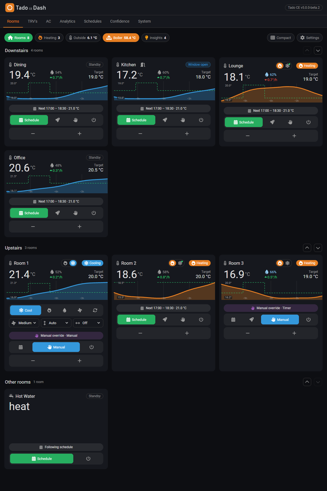

**One room**, with its Heat / Cool switch, controls and a 24-hour chart of temperature, targets, heating and AC power

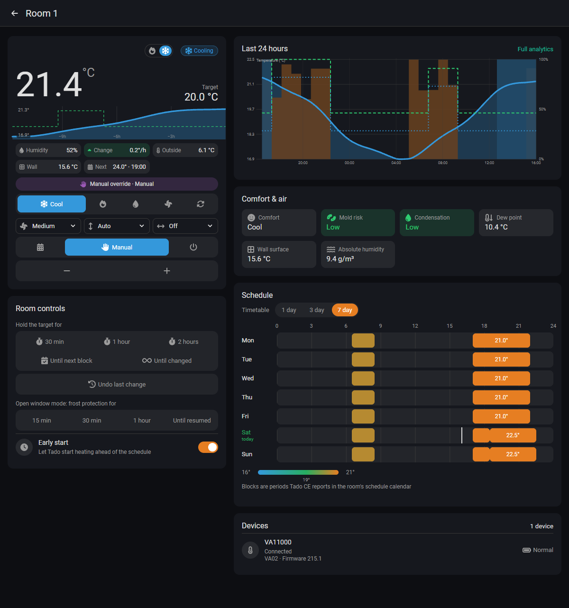

**Room cards**, in a few different states: idle, heating, cooling, a window open, and a manual override. A room with an air conditioner has a Heat / Cool switch on its card.

  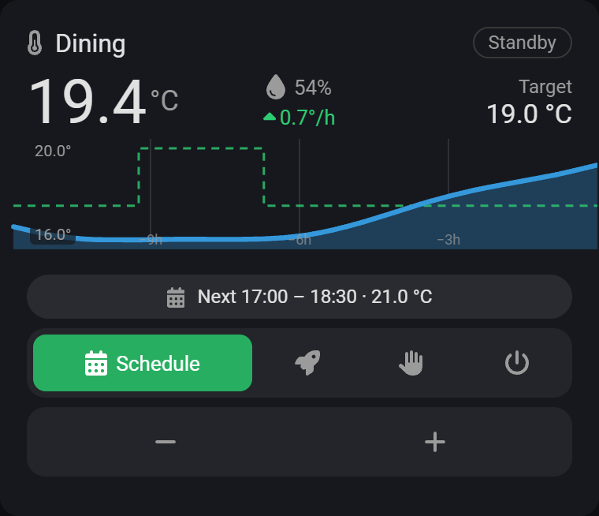
  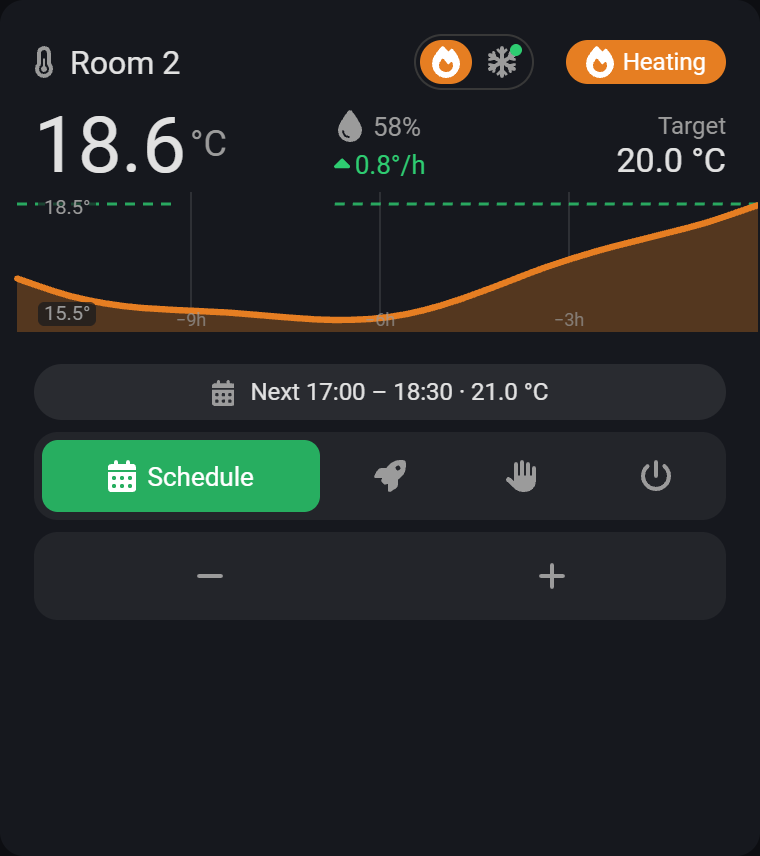
  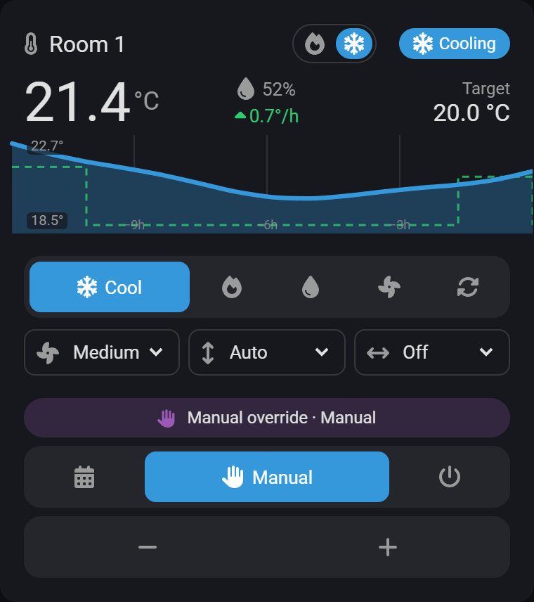
  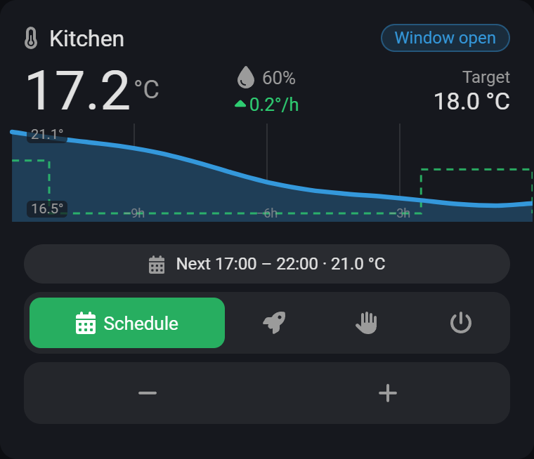
  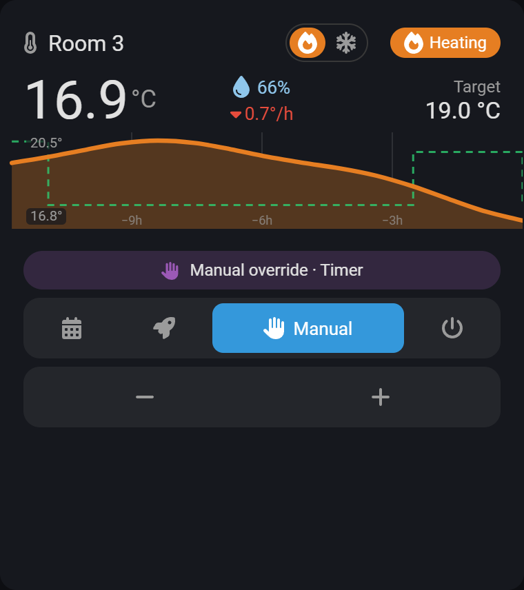

**The boiler card**: it lights the pipework to each room that is calling for heat

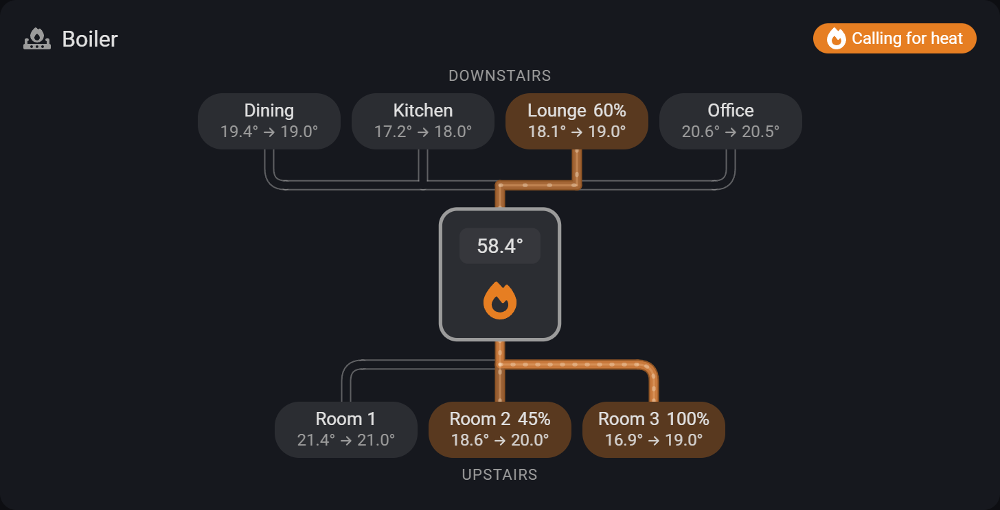

**TRV's**

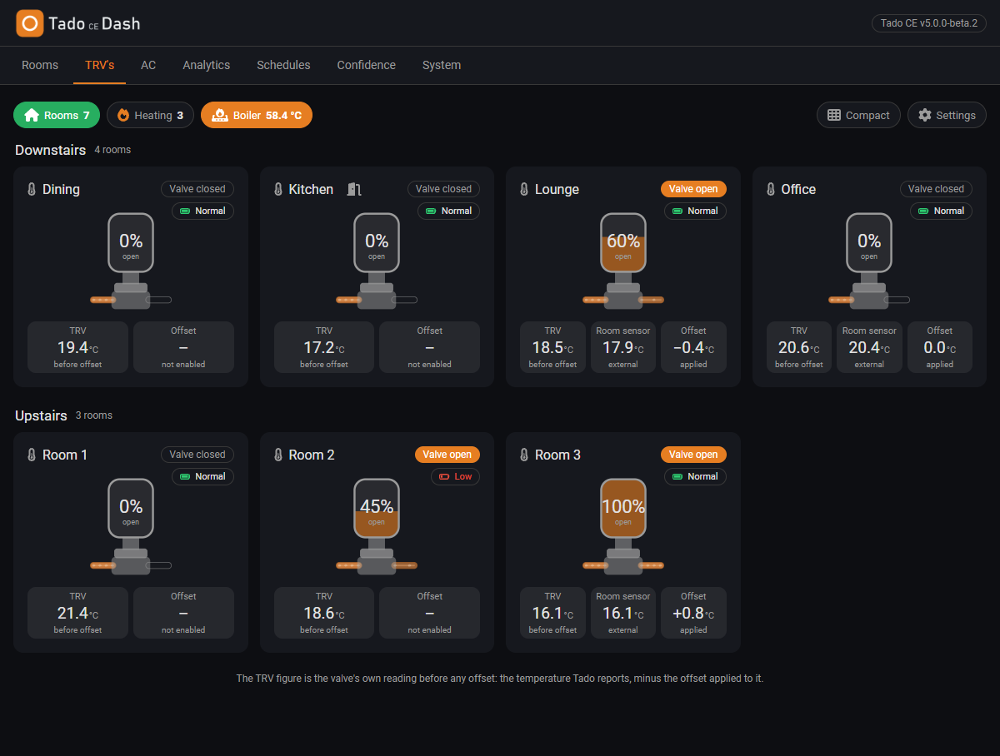

**AC** (beta)

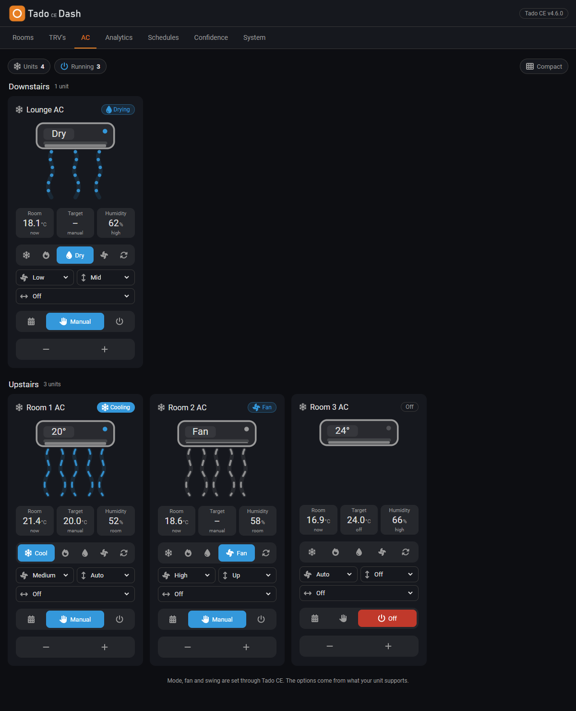

**Schedules**

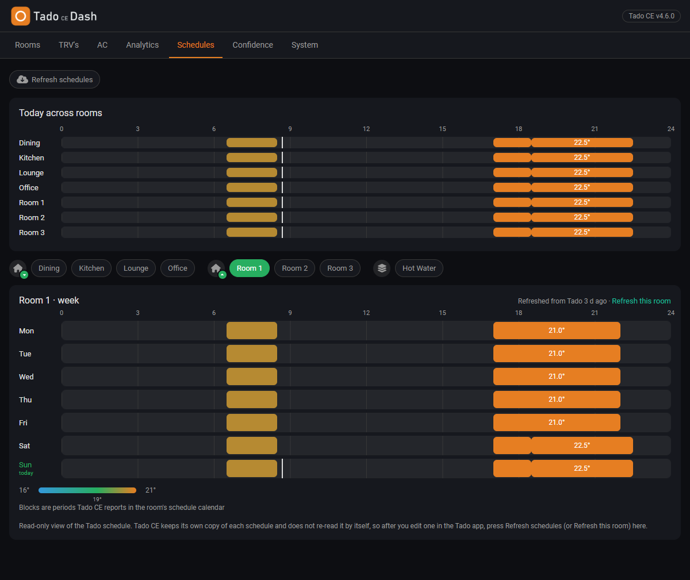

**Analytics**, **Confidence** and **System**

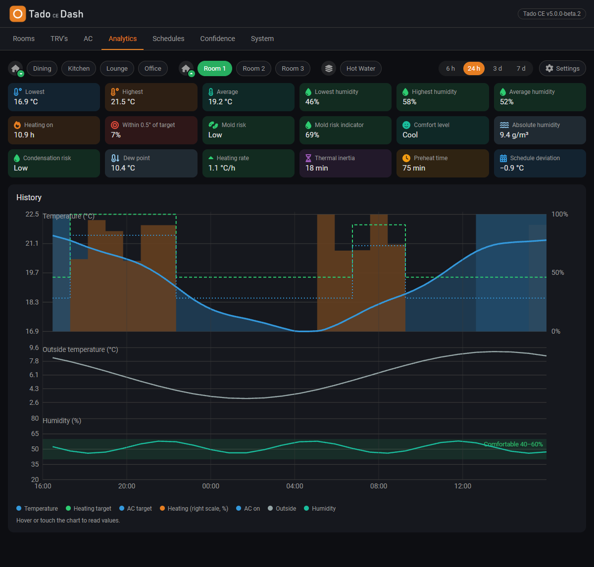

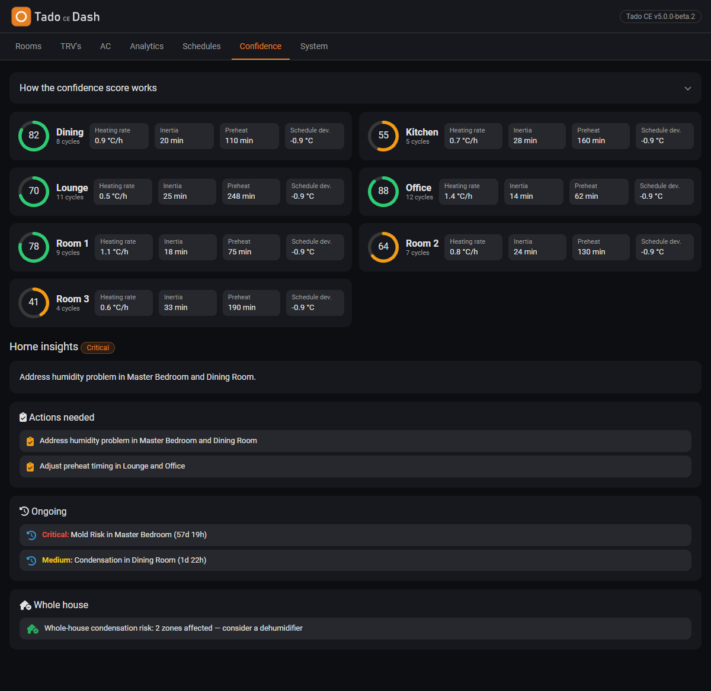

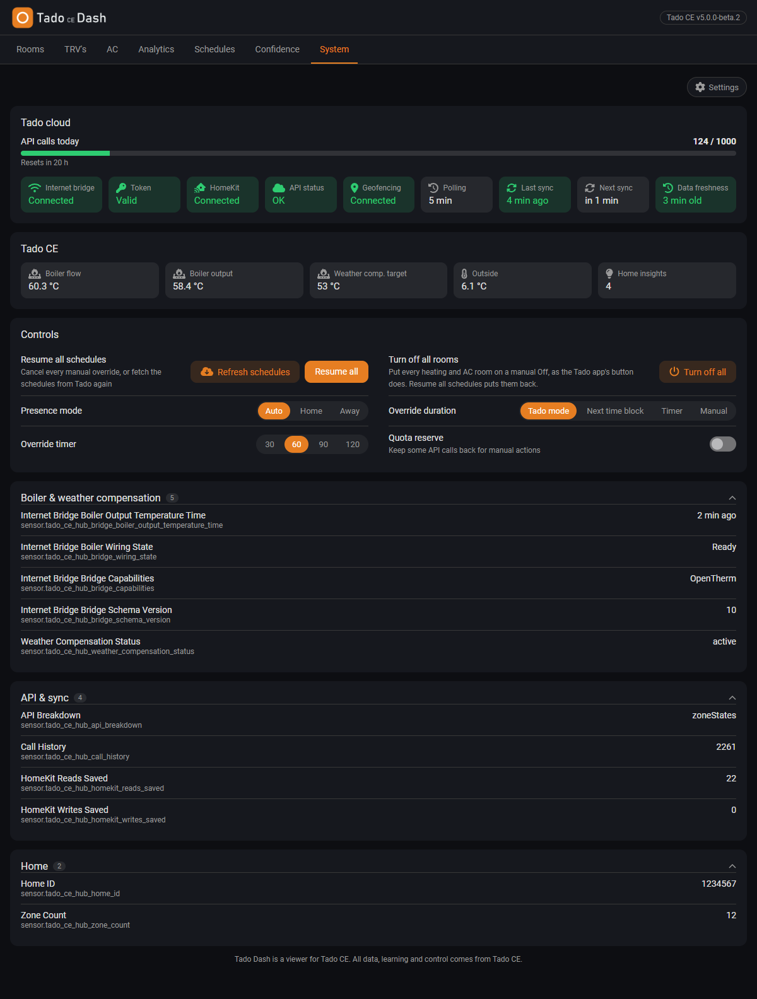

## Credits

Icons are from [Font Awesome Free](https://fontawesome.com) 6.7.2 (solid), licensed [CC BY 4.0](https://fontawesome.com/license/free). They are embedded in the panel, so nothing is loaded from the internet. Colours are from the [Flat UI palette](https://flatuicolors.com/palette/defo).

## Licence

MIT
